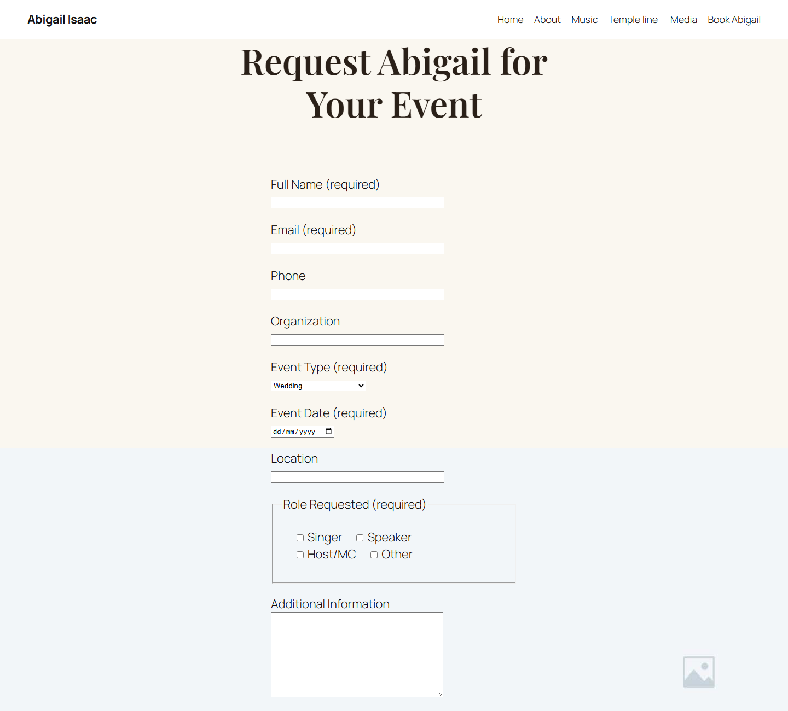
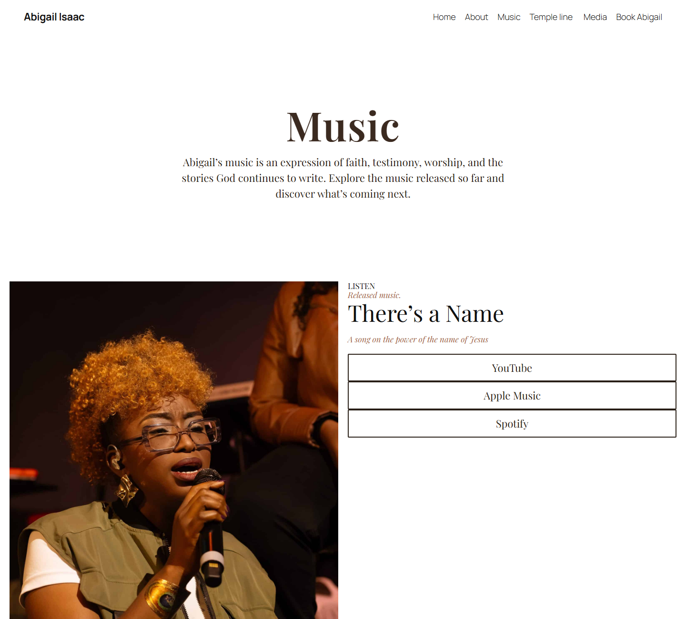
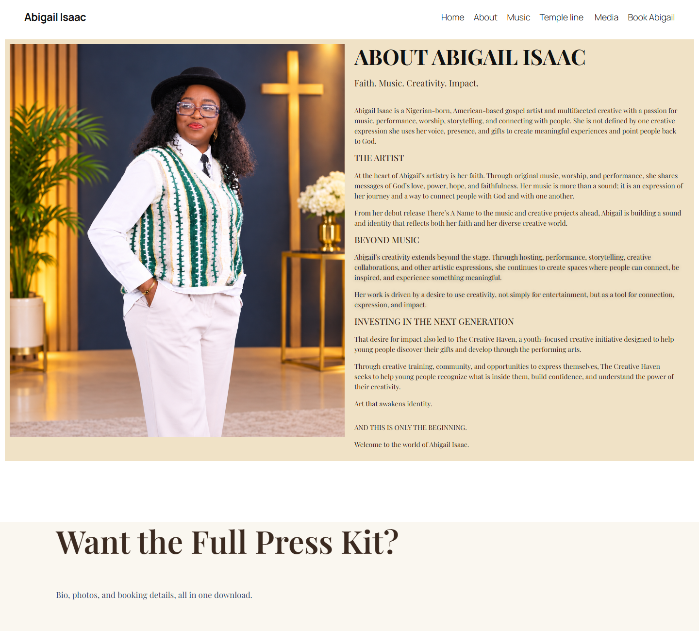
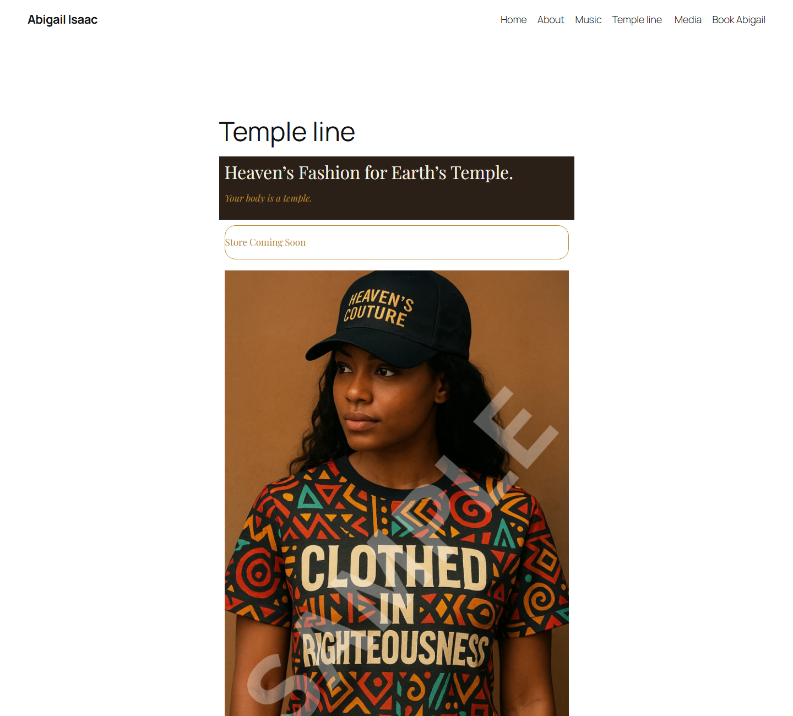
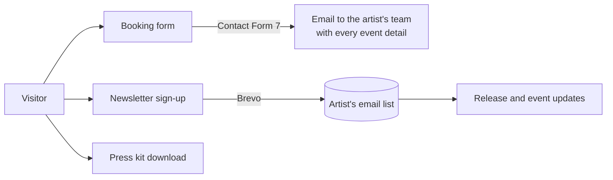

# Artist Website: booking requests, newsletter, press kit and store page

**A WordPress + Elementor website for a gospel artist. It turns visitors into bookings, newsletter subscribers and press contacts: a structured event-booking form, a Brevo-connected newsletter on every page, a press-kit download, music links and a branded store page for her clothing line.**

**Live site:** [abigailisaac.com](https://abigailisaac.com) · Built by [AutoMinds AI Services](https://autominds-ai.github.io)

---

## What the site does for the artist
| Goal | What was built |
|---|---|
| **Get booked for events** | A booking page with a structured request form: event type, date, location, role requested (singer, speaker, host/MC), organisation and details. Every request arrives complete, so there's no back-and-forth to collect basics |
| **Grow an audience she owns** | A newsletter sign-up in the footer of every page, connected to **Brevo**, so subscribers go straight into her email list |
| **Make press and promoters' work easy** | A "Want the full press kit?" section with bio, photos and booking details in one download |
| **Send listeners to her music** | A music page with streaming links (YouTube, Apple Music, Spotify) and an upcoming-releases section |
| **Launch merchandise** | A branded store page for her Temple Line clothing range, ready for products. The client is timing the store launch |
| **Show her work** | A media page for worship, event hosting, live performances and interviews |

## Pages
| Booking | Music |
|---|---|
|  |  |
| **About + press kit** | **Temple Line store page** |
|  |  |

## How enquiries flow

## Tools
`WordPress` · `Elementor` · `Contact Form 7` · `Brevo` · responsive design

## Want a site that brings you enquiries?
AutoMinds AI Services builds websites and automations that capture enquiries and follow up for you, for **real estate teams, clinics** and creative professionals.
**[Book a free 30-minute automation audit →](https://calendly.com/eriksammy79/30min)**

---
Website content, photos and branding belong to the client.
